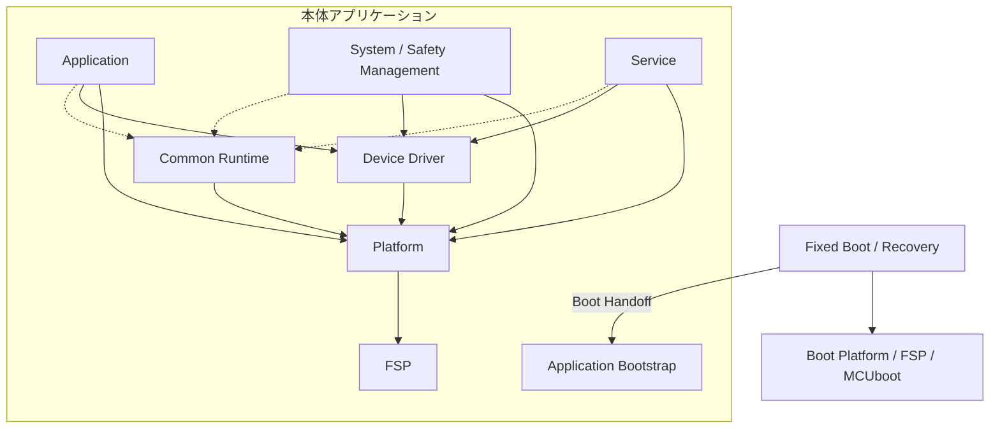

# Tank_Robot 本体ソフトウェアアーキテクチャ詳細設計

## 目次
1. 本書の目的・位置付け
2. ソフトウェア全体構成
3. モジュール構成と責任分界
4. 実行・監視アーキテクチャ
5. インターフェースと依存関係
6. システム横断の設計
7. モジュール詳細設計への引継ぎ

---
## 1. 本書の目的・位置付け
### 1.1 本書の目的
本書は、Tank_Robot本体ソフトウェアについて、基本設計で定めた機能、責任分界および実行方式を実現するためのソフトウェアアーキテクチャを定義する。

主に、ソフトウェア全体の構成、モジュールの責務、実行方式、依存関係、モジュール間のインターフェースおよび複数モジュールにまたがる設計上の取り決めを明確にする。

本書は、個別モジュールの詳細設計を進めるための共通基準とし、モジュール内部の具体的な処理手順や実装アルゴリズムは、原則として各モジュール詳細設計書で定める。

### 1.2 対象範囲
本書は、Tank_Robot本体アプリケーションのソフトウェア全体構成を対象とする。

本書は、Tank_Robot本体で動作するソフトウェアのうち、Fixed Boot / Recoveryを除く本体アプリケーションのソフトウェア構成を対象とする。

本体アプリケーションは、Application、System / Safety Management、Service、Device Driver、Platform、FSPの6層と、これらに共通する実行基盤であるCommon Runtimeで構成する。

また、Fixed Boot / Recoveryと本体アプリケーションとの間で必要となる情報の引継ぎや連携の境界も対象とする。

スマートフォンアプリ、VPS、管理Webアプリの内部構造は対象外とする。ただし、これらとTank_Robot本体との連携に必要な本体側のモジュール構成および責任分界は対象とする。

### 1.3 上位設計との関係
本書は、[Tank_Robot 本体詳細設計について](../00_Tank_Robot_本体詳細設計について.md)に定める共通方針に従い、`50_基本設計/`配下の現行基本設計を直接の設計基準とする。

特に、次の文書をソフトウェア全体構成の主な基準とする。
-[本体ソフトアーキテクチャ基本設計](../../../20_basic_design/07_本体ソフトウェアアーキテクチャ/Tank_Robot本体ソフトアーキテクチャ基本設計.md)
- [Tank_Robotシステムアーキテクチャ](../../../20_basic_design/02_システムアーキテクチャ/Tank_Robotシステムアーキテクチャ.md)
- [Tank_Robot詳細設計引継ぎ基本設計](../../../20_basic_design/09_詳細設計引継ぎ/Tank_Robot詳細設計引継ぎ基本設計.md)

各機能の振る舞い、安全条件、セキュリティ条件、状態遷移および外部インターフェースの意味は、それぞれを定める基本設計に従う。

本書でこれらの仕様を新たに定義または変更しない。基本設計との不一致や実現上の問題が判明した場合は、該当する基本設計へフィードバックする。

### 1.4 モジュール詳細設計との責任分界
本書では、ソフトウェア全体として共通に決定すべき構成、責務、依存方向および連携条件を定める。

各モジュール詳細設計書では、本書で定めた責任分界と共通契約に従い、公開インターフェース、内部データ、状態遷移、関数ごとの処理、異常処理および単体試験に必要な条件を具体化する。

各モジュール詳細設計書は、対象モジュールを実装するために必要な処理規則を、その文書から確認できる構成とする。

本書で定めたモジュール構成、責任分界、公開契約または依存関係を変更する必要が生じた場合は、個別モジュール詳細設計書だけで変更せず、本書および関連する上位設計への影響を確認する。

### 1.5 本書の主な用語
本書では、モジュール名、公開型名およびAPI名には既存の英語表記を使用する。本文で繰り返し使用する主な用語の意味を次に示す。

| 用語 | 本書での意味 |
| --- | --- |
| モジュール（Module） | 機能上の責務、状態およびデータの管理主体となる設計単位 |
| Process | Schedulerから呼び出され、処理を進めた後に戻る協調実行単位。モジュールと必ずしも一対一ではない |
| Common Runtime | Processの実行、進行監視、ランタイム異常および共通データ連携を提供する基盤 |
| READY | Processを実行すべき契機。処理対象データそのものは含まない |
| Checkpoint | 定められた処理区間が正常に進行したことを示す監視用の証拠 |
| Request／Result | 処理の要求／その処理の結果。Requestの受付成功と最終的な処理完了は区別する |
| Provider／Requester | 処理要求を受け付ける側／要求する側のモジュール |
| Snapshot | 管理元が公開する、整合性の取れた状態情報 |
| Primitive（共通処理部品） | キュー、スロット、ラッチなど、複数モジュールから共通利用するデータ保持・受渡しの仕組み |
| E-STOP | 緊急停止（Emergency Stop）。本体の緊急停止スイッチとBLEからの緊急停止要求を区別する |
| ISR／DMA | 割込みサービスルーチン／CPUの処理とは独立してデータを転送する仕組み |
| IWDT | 独立ウォッチドッグタイマ（Independent Watchdog Timer）。指定された時間・更新条件を満たさない場合にリセットを発生させるハードウェア監視機能。更新可否はFixed Boot／Power側で判断する |
| FSP | Renesas Flexible Software Package。RA8M2の周辺機能などを利用するためのソフトウェア基盤 |
| Boot Handoff | Fixed Bootから本体アプリケーションへ引き継ぐ起動情報に関する共有契約 |

用語の詳細なデータ構造や動作条件は、それぞれの担当する基本設計・詳細設計で定める。

## 2. ソフトウェア全体構成
### 2.1 全体構成
Tank_Robot本体アプリケーションのソフトウェアは、次の6層で構成する。

|レイヤ|主な役割|
|---|---|
|Application|走行、砲塔・砲身制御、利用者への状態通知など、機体の動作と利用者操作に関する機能|
|System / Safety Management|システム状態、起動・終了、停止、異常、電源、安全監視など、本体全体の管理と安全に関する機能|
|Service|BLE、Wi-Fi、VPS通信、設定、永続データ、セキュリティ処理など、各機能を支援するサービス|
|Device Driver|外部デバイス固有の通信手順、初期化、動作および内部状態の管理|
|Platform|MCU内蔵周辺機能、割込み、DMAなどのハードウェア制御を抽象化する機能|
|FSP|Renesas RA8M2のハードウェア制御に使用するソフトウェア基盤|

Application、System / Safety Management、Serviceの3層は、製品機能の責任を分類するものであり、厳密な上下の呼出し階層ではない。

これらの機能は、定められた公開インターフェースを介して相互に連携する。

また、Common Runtimeは上位3層に共通する実行基盤として配置する。

Fixed Boot / Recoveryは本体アプリケーションとは分離した実行領域として扱う。

主要な構成と代表的な利用関係を次に示す。

実線の矢印は代表的な利用・引継ぎ関係、破線はCommon Runtimeの利用関係を示す。
いずれもすべての必須呼出しを表すものではない。
上位3層は責務による分類であり、互いに固定された上下関係を持たない。

### 2.2 各レイヤの役割
#### 2.2.1 Application
Applicationには、利用者の操作意図を機体動作へ反映する機能、および利用者向けの状態通知機能を配置する。

走行、砲塔・砲身制御などの機能は、各機能が管理する状態と制御条件に従って処理する。

Applicationの機能は、必要に応じて他の機能モジュール、Device Driver、Platformの公開インターフェースを利用する。

#### 2.2.2 System / Safety Management
System / Safety Managementには、本体全体の状態管理、安全管理、起動・終了、異常管理、電源管理などの機能を配置する。

各機能は、それぞれが担当する状態、判断および処理結果を管理する。

停止、緊急停止、電気安全保護などの安全処理は、通常の通信、ログ保存、OTA更新などの処理完了に依存させない。

#### 2.2.3 Service
Serviceには、通信、設定、永続データ、セキュリティ処理、製品情報、時刻管理などの機能を配置する。

Service層の各モジュールは、担当する責務に従って処理を実行し、必要な情報や操作を公開インターフェースとして提供する。

Serviceに配置することを理由として、各機能が管理する状態や処理結果の意味を他のモジュールへ移さない。

#### 2.2.4 Device Driver
Device Driverは、外部デバイス固有の通信手順、初期化、内部状態およびデバイス操作を担当する。

Device DriverはPlatformを介して物理的な通信やハードウェア操作を行う。

デバイス固有の応答や状態はDevice Driverで解釈するが、製品機能としての最終的な判断は、それを担当する上位モジュールが行う。

#### 2.2.5 Platform
Platformは、RA8M2の周辺機能およびFSPへの依存を隠蔽し、上位にハードウェア制御用のインターフェースを提供する。

GPIO、UART、SPI、I2C、ADC、タイマ、割込み、DMA、IWDTなどの制御を担当する。

FSPのコールバックはPlatformで受け付け、FSPに依存しない状態や処理結果に変換する。

Platformは、通信プロトコルや製品機能の意味上の判断を行わない。

#### 2.2.6 FSP
FSPは、RA8M2の周辺機能を制御するための基盤とする。

FSP固有のAPI、型およびコールバックはPlatform内で扱い、上位レイヤの公開インターフェースへ露出させない。

### 2.3 Common Runtimeの位置付け
Common Runtimeは、Application、System / Safety Management、Serviceの各機能が共通利用する実行・監視・データ連携の仕組みを提供する。

主な構成要素は、Scheduler、SystemMonitor、RuntimeAnomalyおよび共通Primitiveとする。

Common Runtimeは、Processの実行管理、進行監視、ランタイム実行異常の管理、Queue・Slot・Event等の共通機構を担当する。

一方、システム状態、停止成立、安全判定、異常の影響度、認証・認可、設定やOTA更新の処理結果など、製品機能固有の判断は担当しない。

Common Runtimeを利用するために、各機能モジュールが管理する状態や処理結果の意味をCommon Runtimeへ移さない。

Common Runtimeの内部構造および各構成要素の具体的な処理は、それぞれのモジュール詳細設計で定める。

### 2.4 Fixed Boot / Recoveryの位置付け
Fixed Boot / Recoveryは、本体アプリケーションとは分離した実行領域とする。

Fixed Boot / Recoveryは、Boot PlatformおよびFSP / MCUbootを使用し、固定ブート・復旧基本設計で定められた役割を担当する。

本体アプリケーションへの引継ぎにはBoot Handoffを使用する。

Fixed Boot / Recoveryは、本体アプリケーションのProcessとして扱わない。

起動対象の決定、復旧処理、Boot Handoffの生成・検証、IWDT更新責任の移管などについては、既存の基本設計に従い、関連する詳細設計で具体化する。

### 2.5 レイヤ間の依存方向
各レイヤおよびモジュール間の依存は、定められた公開インターフェースを介して行う。

代表的な依存関係は次のとおりとする。

|呼出し元|利用先|
|---|---|
|Application / System / Safety Management / Service|他の機能モジュールの公開インターフェース|
|Application / System / Safety Management / Service|Device Driver|
|Application / System / Safety Management / Service|PlatformのMCU抽象インターフェース|
|Device Driver|Platform|
|Platform|FSP|
|Scheduler|Process Execution Interface、Platformの単調時刻取得機能|

次の依存および直接操作は禁止する。

- Application、System / Safety Management、Service、Device DriverからFSPを直接呼び出すこと。
- 他モジュールの非公開状態や内部データを直接操作すること。
- 他モジュールのProcessを直接呼び出すこと。
- 通信データの受信処理からMotorDriverやServoDriverを直接操作すること。
- Platformが製品機能固有の判断を行うこと。
- 個別Process、ISR、SystemMonitorがIWDTを直接更新すること。

ISRおよびFSPコールバックから通常の機能Processを直接呼び出さず、必要な情報を公開した後、Schedulerを介して対象Processの実行契機を通知する。

具体的なデータ受渡し方式、完了通知およびインターフェースの取り決めは第5章で定める。

### 2.6 初期実行構成の前提
初期製品の本体アプリケーションは、RA8M2のCortex-M85側で実行し、Cortex-M33は使用しない。

初期構成ではRTOSを使用せず、Common RuntimeのSchedulerによる協調実行方式を採用する。

また、初期構成ではD-cacheを無効とする。

将来、Cortex-M33の利用またはD-cacheの有効化を行う場合は、コア間通信、共有メモリ、キャッシュ整合性、排他制御、安全処理への影響など、変更に関係する設計を確認する。

通常のアプリケーションでは動的メモリ確保に依存せず、主要な実行資源を固定容量で管理する。

Processの実行方式、監視方式および時間条件は第4章、固定資源の全体的な管理条件は第6章で扱う。

## 3. モジュール構成と責任分界
### 3.1 モジュール構成の基本方針
Tank_Robot本体ソフトウェアは、機能ごとの責務を持つモジュールと、それらが共通利用する実行基盤、Device DriverおよびPlatformで構成する。

各機能モジュールは、自機能に関する状態、判断、データおよび処理結果の意味を管理する。

他モジュールの情報を利用する場合は、管理元が提供する公開インターフェースを使用し、同じ状態や判断を独立に管理しない。

基本設計上の機能、ソフトウェアモジュールおよび実行単位であるProcessは、必ずしも一対一に対応しない。

### 3.2 機能モジュール一覧
本体アプリケーションの機能モジュールを次に示す。

|レイヤ|モジュール|主な責務|
|---|---|---|
|Application|Drive|走行指令、左右走行制御、走行機能の局所停止|
|Application|TurretBarrel|砲塔・砲身制御、手動基準合わせ後のサーボ動作許可（ARM）、サーボの局所停止|
|Application|StatusNotification|利用者向け状態情報、表示・通知要求の集約|
|System / Safety Management|SystemState|システム状態、状態遷移、操作可否の管理|
|System / Safety Management|StartupShutdown|起動、終了、再起動の処理管理|
|System / Safety Management|Stop|通常停止、安全停止、緊急停止の処理管理|
|System / Safety Management|Fault|異常登録、影響度、処置、復旧可否の判断|
|System / Safety Management|Power|電源状態、低消費電力移行・復帰、IWDT更新の管理|
|System / Safety Management|BatterySafety|バッテリー・電気安全の計測評価、安全判定と保護要求|
|System / Safety Management|SecurityPolicy|状態・権限・セキュリティ情報に基づく操作可否の判定|
|Service|Ble|BLE通信、接続、セッション、認証通信の管理|
|Service|Owner|所有者・操作端末、権限情報の管理|
|Service|WiFi|Wi-Fiモジュール制御、接続・再接続、通信経路の提供|
|Service|Vps|TLS/HTTPS通信、VPSデバイス認証、HTTP処理|
|Service|Config|設定候補、設定適用、確定・ロールバックの管理|
|Service|LogDiagnostic|イベントログ、診断情報、実行統計の収集・送信管理|
|Service|Ota|OTA更新処理、候補イメージ、試行・確定状態の管理|
|Service|Persistence|MRAM・Serial NORへの物理的な保存・読出し|
|Service|SecurityService|暗号処理、認証情報・鍵・信頼情報、SecurityGenの管理|
|Service|ProductData|製品情報、個体情報、校正情報の管理|
|Service|Time|Trusted Time、RTC連携、時刻の信頼状態の管理|

上記の各モジュールは、[本体ソフトアーキテクチャ基本設計](../../../20_basic_design/07_本体ソフトウェアアーキテクチャ/Tank_Robot本体ソフトアーキテクチャ基本設計.md)と、担当する[機能別基本設計](../../../20_basic_design/03_機能別基本設計/)に従う。
各モジュール詳細設計では、担当する基本設計上の機能・責務との対応を明示する。

各モジュールの内部状態、公開インターフェース、処理手順および異常時の動作は、個別モジュール詳細設計で具体化する。

### 3.3 共通基盤および下位モジュール
共通基盤および下位モジュールは、機能モジュールから利用する仕組みを提供する。

|区分|主な構成要素|責任範囲|
|---|---|---|
|Common Runtime|Scheduler、SystemMonitor、RuntimeAnomaly、共通Primitive、完了通知機構など|実行、監視、ランタイム実行異常、共通データ連携|
|Device Driver|BleModuleDriver、WiFiModuleDriver、MotorDriver、ServoDriver、SerialNorDriver、DisplayDriver、PowerHwDriver、PowerMonitorDriver|外部デバイス固有の制御と状態管理|
|Platform|GPIO、UART、SPI、I2C、ADC、Timer、PWM、MonotonicTime、IWDT、CpuSyncなど|MCU周辺機能およびFSP依存の制御・抽象化|

Common Runtime、Device DriverおよびPlatformは、各機能モジュールの製品上の判断を代行しない。

各構成要素の内部設計および公開インターフェースの具体的な動作は、それぞれの詳細設計で定める。

### 3.4 モジュール間の責任分界
複数のモジュールが協調する処理では、状態や処理結果を管理する主体を明確にする。

主な責任分界を次に示す。

|関係するモジュール|責任分界|
|---|---|
|SystemState / Stop|SystemStateがシステム状態と操作可否を管理し、Stopが停止要求と停止処理結果を管理する|
|Stop / Drive / TurretBarrel|Stopが全体の停止処理を集約し、DriveとTurretBarrelがそれぞれの制御対象に対する局所停止を担当する|
|BatterySafety / Power / StartupShutdown|BatterySafetyが電気安全を判定し、Powerが電源状態を管理する。StartupShutdownは起動・終了処理と本体電源遮断に関する担当処理を管理する|
|Scheduler / SystemMonitor / RuntimeAnomaly / Fault|Schedulerが実行を管理し、SystemMonitorが進行状態を評価する。RuntimeAnomalyがランタイム実行異常を管理し、製品上の異常処置はFaultが判断する|
|Ble / Owner / SecurityPolicy / SecurityService|Bleが通信・セッションを管理し、Ownerが端末・権限情報を管理する。SecurityServiceが認証情報・鍵・暗号処理を担当し、SecurityPolicyが公開情報に基づいて操作可否を判断する|
|Config / Ota / Persistence|ConfigとOtaが各処理の成立条件や確定結果を判断し、Persistenceが物理的な保存・読出しを担当する|
|Time / Scheduler|TimeがUTC時刻とその信頼状態を管理し、SchedulerはUTC補正の影響を受けない単調時刻を使用する|

上記は、主な責任分界を示すものであり、各処理のすべての呼出し経路を定義するものではない。

具体的なモジュール間インターフェースとデータ受渡し方式は第5章で定める。

### 3.5 状態・データの管理主体
システム状態、機能状態、Snapshot、Resultなどは、原則として、それぞれの意味を決定するモジュールが管理する。

管理元以外のモジュールは、公開インターフェースを通じて取得した情報を利用し、管理元の状態を直接変更しない。

例えば、システム状態はSystemState、電気安全の判定結果はBatterySafety、走行状態はDrive、停止処理の結果はStopが管理する。

また、Ownerが管理する端末・権限情報と、SecurityServiceが管理する認証情報・鍵の状態は、異なる責務として扱う。

共通PrimitiveがQueueやSnapshot等の保存・受渡し機構を提供する場合でも、そのデータが表す製品上の意味は、当該データを管理する機能モジュールに属する。

複数モジュールで共通のデータ形式を使用する場合も、公開型およびデータの管理主体を明確にし、同じ意味の情報を複数箇所で独立に管理しない。

### 3.6 モジュールとProcessの関係
モジュールは機能上の責務を持つ設計単位であり、ProcessはSchedulerから呼び出される実行単位とする。

初期構成では、第3.2節の機能モジュールのうち、SecurityPolicyを除く20モジュールがそれぞれ一つのProcessを持つ。

SecurityPolicyは短時間の同期問い合わせを提供するモジュールとし、独立したProcessを持たない。

これら20個の機能Processに、Common Runtimeに属するSystemMonitorのProcessを加え、初期構成の登録Process数は21個とする。

具体的なProcess ID、周期、優先度の割当ては、本書で定めるモジュールとProcessの対応および上位基本設計の実行条件を満たすよう、Scheduler詳細設計で定める。

Scheduler、RuntimeAnomalyおよび共通Primitive等は、それぞれの責務を持つCommon Runtime構成要素として扱う。

Processの実行契機、優先度、期限および監視条件は、第4章で全体の実行方式を定め、具体的な設定と動作はSchedulerおよび関連モジュールの詳細設計で定める。

将来、Processを分割または統合する場合も、既存の実行契機、優先度、期限、実行時間上限、監視条件および安全処理の優先関係を維持する。

モジュール構成、Process構成または責任分界を変更する場合は、本アーキテクチャ詳細設計への影響を確認する。

## 4. 実行・監視アーキテクチャ
### 4.1 実行方式
Tank_Robot本体アプリケーションは、RTOSを使用しない協調実行方式を採用する。

通常の処理は、Common RuntimeのSchedulerが管理するProcessとして実行する。
Schedulerは実行可能なProcessを選択して呼び出し、Processが処理を終了して戻った後に、次のProcessを選択する。

各Processは短時間で処理を終了し、外部通信、他Process、デバイス操作、記憶媒体への書込みなどの完了を同期待ちしない。

待ちを伴う処理は、状態遷移、非同期Request／Result、イベント、タイムアウト、分割処理などによって進行させる。

初期構成では、通常Process同士を並列実行しない。
ただし、Process実行中にも割込みやDMAによる状態更新が発生するため、これらとの同期は別途考慮する。

### 4.2 ProcessとSchedulerの関係
Processは、各モジュールの処理を進行させる実行単位とする。

Schedulerは、Processの実行可否、READY、優先度、周期、期限および実行順序を管理する。

READYはProcessを実行する契機を表すものであり、Request、Result、イベントなどのデータ本体は保持しない。データ本体は、それぞれの管理主体が所有するQueue、Slot、Latch等で保持する。

Schedulerは、実行契機に対応するREADY理由をProcessへ渡し、Processはその理由に対応する処理を進める。

各ProcessはScheduler専用のExecution Interfaceを提供する。
他モジュールからProcessを直接呼び出さず、公開インターフェースとSchedulerを介して連携する。

Schedulerは、Process内で行われる製品機能の判断や処理結果の意味を管理しない。

Processの具体的な登録情報、READY管理、選択アルゴリズム、周期処理、期限管理および実行統計はScheduler詳細設計で定める。

### 4.3 優先度と実行時間
Processの実行優先度は、次の4つの優先度区分（Priority Class）で管理する。

|Priority Class|主な対象|
|---|---|
|P0：Safety Immediate|緊急停止など、最優先で開始すべき安全処理|
|P1：Real-time Control / Monitor|走行制御、電気安全監視、進行監視など、時間制約を持つ処理|
|P2：System / Service|状態管理、通信、設定、OTAなどのシステム・サービス処理|
|P3：Background|期限保証を必要としないバックグラウンド処理|

同一Processでも、READY理由によって適用する優先度が異なる場合がある。

P3には、他の処理が優先されることで実行が長時間遅れても、製品の正常動作や安全性に影響しない処理だけを配置する。

一定時間内の実行が必要な処理や、実行されないことでQueueやBufferなどの固定資源が枯渇し、製品の正常動作に影響する処理は、P2以上の優先度を使用する。

Processの通常実行時間は、1回の呼出しにつき0.5 ms以下を設計目標とし、原則として1.0 ms以下を上限とする。

実行時間は、Processの呼出し開始から戻るまでの経過時間で評価する。
Process実行中の割込みや、同期的なDevice Driver／Platformの呼出しに要する時間も含める。

Processの実行開始までの待ち時間、非同期処理の完了時間およびSchedulerの選択処理時間は、Processの実行時間予算とは区別して評価する。

各Processの具体的な優先度、周期、期限、実行時間予算および同順位時の選択規則はScheduler詳細設計で定める。

### 4.4 SchedulerとSystemMonitorの責任分界
Schedulerは、Processの実行を管理するとともに、実行時間や実行開始までの遅延を計測・記録し、実行時間の上限超過や期限超過を検出する。

SystemMonitorは、現在のシステム状態や処理段階に応じて、必要なProcessが正常に進行しているかを評価する。

SystemMonitorは、各Processが報告するCheckpoint、監視世代、進行期限およびランタイム基盤の健全性を使用し、監視結果を公開する。

Checkpointは、Processが実行されたという事実だけではなく、担当する処理区間が定められた条件に従って正常に進行したことを示す情報とする。

SystemMonitorは、Processの実行順序や優先度を決定しない。
また、各機能が何を正常完了とみなすかを独自に定義しない。

監視対象、監視フェーズ、Checkpointの受付、進行停止判定および監視結果の具体的な管理方法はSystemMonitor詳細設計で定める。

### 4.5 SystemMonitorとIWDTの関係
IWDTの更新には、現在の監視条件に対応する正常な進行証拠を使用する。

SystemMonitorは、必要なProcessの進行状況と共通実行基盤の健全性を評価し、その結果を`SystemMonitorEvaluationSnapshot`として公開する。

IWDTの更新判断および更新命令の実行は、SystemMonitorではなく、現在のIWDT管理主体が担当する。

起動時はFixed Boot側がIWDT更新を管理し、所定の条件に従って本体アプリケーションのPowerへ管理責任を移管する。

Powerは、管理責任の移管後、現在の監視結果とIWDT更新条件に基づいて更新の可否を判断する。

個別Process、ISRおよびSystemMonitorからIWDTを直接更新しない。

過去の監視結果や、現在の監視フェーズに対応しないCheckpointを、新しい正常進行の根拠として再利用しない。

IWDT管理責任の移管、更新条件および低消費電力中の監視方式は、関連する詳細設計で具体化する。

### 4.6 RuntimeAnomalyとFaultの責任分界
SchedulerおよびSystemMonitorが検出した実行上の異常は、Common RuntimeのRuntimeAnomalyで管理する。

RuntimeAnomalyは、同一異常の継続状態、解消、通知状況およびFaultへの通知処理を管理する。

Faultは、通知された異常について、FaultId、製品への影響、処置および復旧可否を判断する。

RuntimeAnomalyは製品上の停止方法、システム状態遷移、再起動または電源遮断を独自に決定しない。

RuntimeAnomalyからFaultへの異常通知が遅延した場合でも、安全上必要な処理を遅らせない。

また、SystemMonitorの監視結果などからIWDTの更新条件を満たしていないと判断された場合は、Faultへの通知完了を待たずに、PowerがIWDTの更新を停止する。

異常の識別、通知経路、通知の再試行および内部資源管理はRuntimeAnomaly詳細設計で定める。

### 4.7 状態変化・低消費電力時の実行と監視
Processの実行可否と監視対象は、別の条件として管理する。

システム状態や処理段階が変化した場合は、担当するモジュールが必要な実行・監視条件の変更を要求する。SchedulerやSystemMonitorが製品状態の意味を独自に推測して切り替えない。

低消費電力中は、Powerが管理する移行条件に従い、Schedulerの実行対象とSystemMonitorの監視方式を切り替える。

標準のSoftware Standbyでは、通常の10 ms周期監視を休止し、間欠復帰時の監視処理を使用する。

通電維持監視モードでは、必要な監視Processの周期実行を維持する。

低消費電力中に保持したREADYは、復帰後の実行条件に従って扱う。
一方、復帰前のCheckpointや監視結果を、復帰後の正常な進行を示す新しい証拠としてそのまま再利用しない。

具体的な実行制限、監視世代、休止・再開条件およびIWDT更新条件は、Power、Scheduler、SystemMonitor等の詳細設計で定める。

### 4.8 共通時刻・Deadlineの契約
Processの周期、実行期限、タイムアウトおよび進行監視には、UTC／RTCの時刻補正に影響されない単調時刻を使用する。低消費電力をまたいでも、経過時間を無視して期限を延長しない。

期限は、Process開始・完了期限、トランザクションの正常処理期限（Forward）、失敗後の復旧期限（Recovery）、最終的な安全作用を保証する独立上限（Terminal Guard）など、意味を区別して管理する。

親トランザクションから子Requestへ期限を継承する場合、子Requestの完了期限が親トランザクションの完了期限を超えないようにする。再試行、再接続、子Requestの再発行によって親の正常完了期限を延長せず、通常処理の失敗を後続の復旧成功へ読み替えない。

リセットをまたいで継続する処理では、リセット前までの経過時間を引き継ぎ、処理全体に定められた制限時間の残りを算出する。
リセットが発生しても、制限時間を最初から数え直さない。

時間の計算方法および復旧処理の具体的な手順は、担当するモジュール詳細設計で定める。
各処理の制限時間は、該当する基本設計に従う。

## 5. インターフェースと依存関係
### 5.1 モジュール間インターフェースの基本方針
各モジュールは、自身が管理する状態および処理を、定められたインターフェースを通じて他モジュールへ提供する。

インターフェースは、次の3つに区分する。

| 区分                  | 用途                                 |
| ------------------- | ---------------------------------- |
| Public Interface    | 他モジュールからの要求、結果取得、状態参照、イベント通知など     |
| Execution Interface | SchedulerからProcessを実行するためのインターフェース |
| Private / Internal  | モジュール内部の処理およびデータ管理                 |

他モジュールから利用できるのは、原則としてPublic Interfaceに限定する。

Processの実行関数、内部状態、内部Queue、非公開データなどを、他モジュールから直接操作しない。

Public Interfaceでは、要求の受付と処理の完了を区別し、同期的に処理結果が確定しない操作は非同期処理として扱う。

停止・緊急停止などの安全処理では、安全確保に必要な出力禁止を、短時間で実行できる専用のインターフェースから要求する。

ただし、インターフェースの呼出しが成功しても、それだけで出力禁止が完了したとは判断しない。出力禁止状態や停止結果は、担当するモジュールが別途確認する。

### 5.2 モジュール間の依存関係
モジュール間の連携は、依存先が公開するインターフェースを通じて行う。

機能上の情報が双方向に流れる場合でも、互いの非公開データを参照したり、公開ヘッダの循環依存を発生させたりしない。

依存関係については、次の原則を守る。

- 各モジュールは、他モジュールのPrivate / Internalに依存しない。
- ProviderのPublic Interfaceに、利用側モジュールのPrivate型を含めない。
- Common Runtimeは、製品機能固有の状態や判断に依存しない。
- Device Driverの公開インターフェースにFSP固有型を露出させない。
- Platformは、上位モジュールの型や製品機能の意味判断に依存しない。
- 別モジュールのProcessを直接呼び出さない。

モジュール間で共通の型が必要な場合は、管理主体となるモジュールが公開する型を使用する。

Fixed Bootと本体アプリケーションの間で共有する`BootHandoff`など、単一モジュールだけでは管理できない契約については、共通契約（Shared Contract）として定義してよい。

ただし、機能固有の型を一つの巨大な共通型定義へ集約しない。

### 5.3 データの管理と受渡し
状態、Request、Result、Snapshotなどのデータは、それぞれの意味を決定するモジュールが管理する。

利用側は、管理元が公開した情報を参照し、同じ意味の状態や判断結果を独立して管理しない。

モジュール間の主なデータ受渡し方式を次に示す。

|情報の種類|基本的な受渡し方式|
|---|---|
|継続的な操作指令|最新値を保持するSlot|
|順序を維持するRequest|固定容量QueueまたはProviderが管理するRequest領域|
|非同期処理のResult|Providerが管理するResult領域|
|状態情報|一貫性を保証したSnapshot|
|発生有無を通知するEvent|EventFlag|
|発生回数を保持するEvent|EventCounter|
|安全事象|SafetyLatch|
|ISRから通常Processへのデータ受渡し|ISR対応の固定容量Queue等|

これらの共通機構にはCommon RuntimeのPrimitiveを利用できる。

ただし、Primitiveはデータの保持や受渡しを担当するものであり、データが表す製品上の意味を判断しない。

データを更新して実行契機を通知する場合は、原則として次の順序を守る。

1. データ本体を更新する。
2. 必要な状態、世代またはResultを公開する。
3. SchedulerへREADYを通知する。

READYにはデータ本体を含めず、利用側Processが起動した後に、管理元のインターフェースを通じて取得する。

BLEやVPSの通信データ形式は、内部の機能データ型と分離する。
通信形式の解析・検証を行ったうえで、担当機能の公開契約に対応付ける。

### 5.4 非同期Request／Result
通信、記憶媒体へのアクセス、暗号処理など、完了まで待ちが発生する処理は、原則として非同期Request／Result方式を使用する。

Requestを受け付けるモジュールをProvider、処理を要求するモジュールをRequesterとする。

Providerは、必要な入力情報および固定資源を確保できた場合にRequestの受付成功を返す。

**Requestの受付成功は、要求された処理の完了や成功を意味しない。**

処理完了後のResultはProviderが保持し、Requesterが公開インターフェースから取得する。

受け付けたRequestの識別子、処理状態、Resultおよび必要な固定資源は、原則としてProviderが管理する。Common Runtimeに全Provider共通のRequest管理機能やディスクリプタプールは設けない。

非同期処理では、次の区別を維持する。

|操作|意味|
|---|---|
|Submit|Requestの受付を要求する|
|TakeResult|完了Resultを取得し、対応するProviderの実行時資源を解放する|
|AbandonResult|Resultの受領が不要になったことを明示する|
|Cancel|Providerが対応している場合に、処理の取消しを要求する|

AbandonResultはCancelを意味しない。
また、Cancelの受付だけで処理が停止したものとは扱わない。

タイムアウト、Requesterの世代変更、状態遷移などによって、Providerの実行時資源を暗黙に解放しない。

入力バッファを共有する場合は、データの所有関係と再利用可能となる条件を明確にする。
DMA等の下位処理がアクセスしている間は、バッファやディスクリプタを再利用しない。

各Requestの具体的な受付条件、処理結果、資源の確保・解放および取消し動作は、Providerの詳細設計で定める。

### 5.5 完了通知とREADY
非同期処理の完了通知には、処理結果の保持とProcessの実行契機を分離する方式を採用する。

ProviderはResultを公開した後に、完了通知先を対応付ける仕組み（Completion Binding）を通じてRequesterのProcessへREADYを通知する。

非同期処理が完了したときに通知するProcessとREADY理由は、要求元と処理の種類に応じて、あらかじめ定義する。

Requesterが、通知先のProcessやREADY理由、実行優先度を自由に指定できる仕組みにはしない。

完了通知には、次の2つの仕組みを区別して使用する。

|仕組み|用途|
|---|---|
|`CompletionRuntimeBinding`|機能モジュール間の論理的な完了通知|
|`PlatformCompletionBinding`|Platformにおける物理的な非同期操作の完了通知|

これらは異なる契約として扱い、IDやBindingの意味を共用しない。

FSPのコールバックはPlatformで受け付ける。Platformは物理処理の結果を保持し、所定のBindingを使用してSchedulerへREADYを通知する。

Device Driverや機能ProcessをFSPコールバックから直接呼び出さない。

また、完了通知に失敗した場合でも、既に確定したResultを未完了へ戻したり、失ったりしない。
Resultの保持、通知再試行および後処理は、それぞれの管理主体と共通契約に従って行う。

### 5.6 公開インターフェースの契約
各モジュールの公開インターフェースは、関数名だけでなく、呼出し側が正しく利用するために必要な契約を定義する。

個別モジュール詳細設計では、少なくとも次の事項を明確にする。

- 呼出し可能なコンテキスト（Process、ISR、安全処理経路など）
- 引数、戻り値および同期戻り値の意味
- ブロッキングの可否と同期実行時間の条件
- 入力データの所有関係と出力データの有効期間
- 再入可能性および同一要求の再実行時の扱い
- 世代・識別子によるRequest／Resultの対応付け
- エラー、不明状態、タイムアウト時の動作

呼出し可能と明示されていない公開インターフェースをISRから使用しない。

また、同期型の公開インターフェースの内部で、他Process、通信、記憶媒体アクセス、暗号処理その他の非同期操作の完了を待機しない。

具体的な公開関数名、型、引数、戻り値、処理手順および異常処理は、各モジュール詳細設計で定める。

### 5.7 依存循環と安全処理の分離
モジュール間の依存関係では、ソースコード上の循環参照だけでなく、実行時の待ち関係も確認する。

例えば、モジュールAが資源を保持したままモジュールBのResultを待ち、モジュールBもモジュールAが保持する資源を必要とする構造を作らない。
ここでいう「待ち」は、Process内で処理を止める同期待ちではなく、非同期処理の完了を待つ間も資源を保持している状態を指す。

必要に応じて、Requestの発行順序、資源予約、非同期化、タイムアウト後の処理および資源解放方法を個別モジュール詳細設計で明確にする。

また、安全上必要な初動処理は、通常のRequest／Result、完了通知、ログ保存、暗号処理などの完了待ちに依存させない。

安全処理の独立性を維持したうえで、後続の結果確認や資源回収を行う。

具体的な安全処理の連携関係は第6章で扱う。

## 6. システム横断の設計
### 6.1 基本方針
本章では、複数のモジュールが協調して実現する処理について、全体的な責任分界と連携の原則を定める。

各モジュールが管理する状態、処理条件および処理結果の意味は、それぞれの管理主体に保持する。

本章では、個別機能の状態遷移、処理手順、判定条件および内部インターフェースを再定義しない。
これらは、関連する基本設計および各モジュール詳細設計に従う。

また、安全処理や異常時の保護動作を、通常の通信、ログ保存、暗号処理などの完了待ちに依存させない。

起動、リセット、通信再接続、低消費電力復帰、異常復旧、E-STOP解除およびOTA更新後も、過去の走行・砲塔・砲身操作を自動再開しない。
通常操作の再開には、現在の状態、安全、認証・権限条件を満たした後に受信した新しい有効指令を使用する。

### 6.2 起動・終了・再起動
#### 6.2.1 起動
起動処理は、Fixed Boot / Recovery、Application BootstrapおよびStartupShutdownが分担する。

Fixed Boot / Recoveryは、起動対象イメージの検証、必要な復旧処理、起動情報の生成および本体アプリケーションへの引継ぎを担当する。

Application Bootstrapは、Boot Handoffの検証、安全な初期状態の確保、最小限のPlatform・Common Runtime・機能モジュールの初期化、およびSchedulerの起動準備を担当する。

Scheduler開始後の起動処理はStartupShutdownが管理し、各機能モジュールに必要な起動時処理、情報の復旧および通常動作への移行を進める。

起動中は、正常動作に必要な状態や監視結果が確立するまで通常操作を許可しない。

Applicationへの分岐後も、Powerへの管理責任の移管が確定するまでは、Fixed Boot領域にある`BootWatchdogService`だけがIWDT更新を判断・実行する。
Application BootstrapおよびStartupShutdownは、起動処理が所定の段階まで進んだことを報告する。
同じ進行段階の報告を繰り返すだけでIWDTを無条件に更新したり、本体アプリケーション側から代わりに更新したりしない。

StartupShutdownはFixed Boot側とPower側の受入れ・確定手順を調整する。
移管確定後はPowerだけがIWDTを更新し、移管前後で複数の管理主体が同時に更新しない。
具体的な共有契約と移管手順はFixed Boot、StartupShutdownおよびPowerの詳細設計で定める。

#### 6.2.2 終了・再起動
通常終了および計画再起動の処理はStartupShutdownが管理する。

StartupShutdownは、SystemState、Stop、Power、Persistenceその他の関係するモジュールと連携し、通常操作の禁止、安全な出力状態の確保、必要な保存および終了・再起動処理を進める。

終了処理はScheduler上の非同期処理として進め、必要な処理が残っている段階でSchedulerを先に停止しない。

終了時に安全上の保護動作が必要となった場合は、通常の保存や通信終了の完了を待たず、安全処理を優先する。

#### 6.2.3 リセットをまたぐ情報
リセットにより、SchedulerのREADY、実行途中のRequest／Result、Checkpoint等の実行時状態は破棄する。

リセット後に復旧する情報は、各機能の基本設計で永続的な保持・復旧対象とされた情報に限定する。

Fixed Bootから引き継ぐ情報、永続データおよびリセットをまたぐ時間情報は、それぞれの管理主体が定められた条件で検証し、必要な状態を再構築する。

リセット前の操作指令や処理状態を、そのまま通常動作として再開しない。

### 6.3 停止・緊急停止および電気安全
#### 6.3.1 停止処理の責任分界
通常停止、安全停止および緊急停止の全体的な処理はStopが管理する。

DriveとTurretBarrelは、それぞれの制御対象について、出力禁止、旧指令の失効および局所停止の確認を担当する。

Stopは各制御機能の結果を使用して停止処理を管理するが、Driverへの要求受付だけを停止完了と判断しない。

また、制御側の停止確認と、機械的な完全停止の実測は区別する。
制御側の正常結果を、実速度や機械的停止を直接測定した結果として扱わない。

#### 6.3.2 緊急停止
本体のE-STOPでは、ソフトウェアとは独立したハードウェア停止経路と、ソフトウェアによる後続処理を併用する。

ハードウェア経路は、MCUやSchedulerの実行を待たずに、走行出力禁止およびサーボPWM出力禁止へ作用する。

ソフトウェア経路では、検出した安全事象を保持し、Stopの優先処理を通じてDrive、TurretBarrel等の状態を安全側へ収束させる。

BLEからのE-STOPは、本体E-STOPの独立ハードウェア経路とは区別し、通常受信処理より優先するソフトウェアの安全処理経路を使用する。

いずれの場合も、ログ記録、Fault通知、表示更新などの完了を、安全上必要な初動処理の前提にしない。

#### 6.3.3 電気安全と電源制御
BatterySafetyは、電気安全の計測・判定と、安全上必要な保護要求を担当する。

Powerは電源状態と電源系統の制御を担当し、BatterySafetyが確定した安全判定を独自に再判定しない。

電源系統の有効化には、通常の電源要求だけでなく、BatterySafetyの安全許可およびハードウェア保護条件を反映する。

安全上、対象電源系統の遮断が必要となった場合は、BatterySafetyからPowerへ保護要求を通知する。

一方、危険低電圧などによって本体電源の遮断が必要と確定した場合は、BatterySafetyからStartupShutdownへの専用の安全処理経路を使用する。
この経路は、Powerの通常要求やFault通知の完了を前提としない。

独立したハードウェア保護は、ソフトウェアによる判定や停止処理で置き換えない。

### 6.4 低消費電力への移行・復帰
低消費電力の移行・復帰はPowerが管理し、SystemState、Scheduler、SystemMonitor、BatterySafetyおよび関連機能が協調する。

初期構成では、次の2つの実行モードを使用する。

|実行モード|全体的な動作|
|---|---|
|Standard Standby（標準待機モード）|Software Standbyを使用し、間欠復帰時に必要な電気安全・システム監視を行う|
|Powered Monitor（通電維持監視モード）|必要な電源系統を通電したまま、電気安全監視とシステム監視の周期実行を維持する|

両モードとも、SystemStateでは同じ低消費電力状態として扱う。実行モードの違いによって新しいシステム状態を追加しない。

Powerは、電源系統の状態、BatterySafetyの監視条件および必要な実行資源を確認して、実行モードを選択する。

SystemStateは、移行条件が成立した段階で低消費電力状態への移行を確定し、Schedulerは対応する実行制限を適用する。
SystemStateによる状態確定とSchedulerへの実行制限の適用は、Powerの準備結果に対応させ、同一の`SystemState_Process`呼出し内で所定の順序に従って実施する。

実際の低消費電力命令へ進む直前には、SchedulerとPlatformの境界で保留中の安全事象・復帰事象を確認し、進入禁止条件が成立した場合は移行を保留または取り消す。
割込みによる新しい安全事象を取りこぼしたまま低消費電力状態へ進入しない。

SystemMonitorは、選択されたモードに応じて監視方式を切り替える。

低消費電力中も必要な安全監視を維持できない場合は、低消費電力状態へ移行または継続しない。

復帰時は、現在の安全条件、システム状態および認証・操作許可条件を改めて確認する。

**低消費電力から復帰しただけで、復帰前の走行・砲塔・砲身操作を自動再開しない。**

低消費電力時の実行制限、監視方式、時間補償、IWDT更新および復帰処理の具体的な手順は、Power、Scheduler、SystemMonitor等の詳細設計で定める。

### 6.5 セキュリティ・通信・OTAの責任分界
#### 6.5.1 セキュリティ
セキュリティに関する処理は、通信、権限管理、ポリシー判定、暗号処理および秘密情報の管理に分離する。

主な責任分界は次のとおりとする。

|モジュール|主な責任|
|---|---|
|Ble|BLE通信、接続・セッション、認証に必要な通信処理|
|Owner|所有者・操作端末、役割・権限情報|
|SecurityPolicy|公開された状態・権限・セキュリティ情報に基づく操作可否の判定|
|SecurityService|暗号処理、認証情報・鍵・信頼情報、SecurityGenの管理|
|Time|Trusted Timeおよび時刻の信頼状態|
|Persistence|セキュリティ関連データの物理的な保存・読出し|

SecurityPolicyは必要な情報を読み取って短時間で判定し、認証情報や鍵の状態を独自に管理しない。

SecurityServiceは暗号処理とセキュリティ情報を管理するが、Ownerが管理する端末の役割・権限情報を独自に更新しない。

通信認証が成功した場合でも、それだけで走行などの操作を許可しない。
現在のシステム状態、操作権限、安全条件および対象機能の受付条件を満たす必要がある。

緊急停止などの安全処理は、SecurityPolicyやSecurityServiceの通常処理完了を待たない。

#### 6.5.2 OTA更新
OTA更新では、Otaが更新処理全体の進行と結果の意味を管理する。

Vpsは更新データの通信、Persistenceは物理的な保存、SecurityServiceは必要な暗号学的検証とセキュリティ情報の管理、ProductDataは製品識別情報の提供を担当する。

Fixed Boot / Recoveryは、起動時のイメージ検証、インストール、試行起動および必要な復旧処理を担当する。

Otaはこれらの結果を組み合わせて更新処理を管理し、通信完了や保存完了だけをOTA更新全体の成功と判断しない。

固定ブートと本体アプリケーションの間では、ファームウェアの信頼性およびSecurityGen等に関する共通の契約を維持する。

OTA更新中も、停止・緊急停止、電気安全監視などの安全処理を優先する。

### 6.6 ハードウェア制御・計測との連携
ハードウェア制御では、機能モジュール、Device DriverおよびPlatformの責任を分離する。

機能モジュールは制御・判定の意味を管理し、Device Driverは外部デバイス固有の操作を管理する。
PlatformはMCU周辺機能とFSPに依存する処理を担当する。

ISRおよびDMAによる処理は、通常Processとは独立して進行するため、データの公開、バッファの所有関係および処理結果の対応付けを明確にする。

特に、BatterySafetyの電気安全監視では、1 ms周期のADC／DMAサンプル取得と、10 ms周期の安全判定処理を分離する。

取得したサンプルは、欠損や順序の情報を保持してBatterySafetyへ引き継ぐ。
計測データの欠損を正常値で補完して安全判定に使用しない。

また、ADC周辺機能自身の校正はPlatform、製品・センサ固有の校正情報はProductData、校正情報を使用した安全判定はBatterySafetyが担当する。

DMAバッファや非同期デバイス操作の資源は、下位処理が使用している間に再利用しない。

具体的な割込み処理、DMA構成、サンプルバッファ、デバイス操作および計測判定は、各Driver、Platformおよび機能モジュールの詳細設計で定める。

### 6.7 固定資源・診断・成立性評価
本体ソフトウェアは、固定容量のメモリ、Queue、Buffer、Request領域などを使用する。

固定資源は、通常処理、安全処理、DMA用バッファ、暗号処理用の一時領域およびリセットをまたぐ引継ぎ情報などの用途を区別して管理する。
具体的な領域配置、初期メモリ予算、容量およびリンカ設定は、各モジュール・Platformの詳細設計で必要量を具体化し、全体の資源割当てとして整合を確認する。

全体の資源使用量については、[性能・品質・検証基本設計](../../../20_basic_design/08_性能・品質・検証/Tank_Robot性能・品質・検証基本設計.md)のCPU、RAM、スタック、キュー等の目標・評価条件に従う。
メモリ予算は、採用する実装方式と資源の必要量を確認したうえで定める。

各資源は管理主体、最大使用量、占有・解放条件を明確にし、同一の物理領域を複数のモジュールが使用する場合も、重複または計上漏れが生じないように管理する。

安全処理に必要な予約資源は、通常の通信、ログ、暗号処理、OTA更新などによって使用不能にならないようにする。

また、重要な非同期処理の成立性は、入口のRequest領域だけでなく、その処理が依存するDriver、バッファ、暗号処理等の資源も含めて確認する。

実行状況や資源使用量は、Common Runtimeおよび各モジュールが必要な情報を提供し、LogDiagnostic等から観測できる構成とする。

全体の成立性評価では、通常負荷だけでなく、通信、制御、暗号処理、記憶媒体アクセス、OTA更新および安全事象が重なった条件を考慮する。

評価結果によって、既存の実行時間、応答期限、メモリ上限、安全条件等を満たせないことが判明した場合は、値を無断で緩和せず、定義元の設計へフィードバックする。

具体的な資源容量、計測方法、評価条件および未評価事項は、関連する詳細設計と評価計画に引き継ぐ。

## 7. モジュール詳細設計への引継ぎ
### 7.1 基本方針
各モジュール詳細設計では、本書で定めたソフトウェア構成、モジュールの責務、実行方式、依存関係および共通契約を前提として、実装に必要な内部設計を具体化する。

各モジュールが担当する状態、データ、公開インターフェース、処理手順および異常時の動作は、担当するモジュール詳細設計書で確認できる構成とする。

本書で確定したモジュール間の責任分界を個別設計で変更せず、基本設計で確定した外部動作、安全条件、セキュリティ条件等も再定義しない。

### 7.2 詳細設計への引継ぎ範囲
主な引継ぎ先と具体化する内容を次に示す。

| 引継ぎ先                      | 具体化する内容                                                        |
| ------------------------- | -------------------------------------------------------------- |
| 機能モジュール詳細設計               | 公開インターフェース、内部状態・データ、状態遷移、正常・異常処理、非同期Request／Result、時間条件、使用資源   |
| Scheduler詳細設計             | Process設定、READY管理、優先度、実行順序、周期・期限管理、実行統計                        |
| SystemMonitor詳細設計         | 監視フェーズ、Checkpoint、監視世代、進行状態の評価、IWDT判断に使用する監視結果                 |
| RuntimeAnomaly詳細設計        | ランタイム実行異常の識別、継続・解消、Fault通知とその管理                                |
| 共通Primitive・非同期連携の詳細設計    | Queue、Slot、Latch、共通時間演算、Request／Result共通契約、完了通知Binding等の具体的な動作 |
| Device Driver詳細設計         | 外部デバイス固有の制御、通信手順、非同期操作、状態管理、安全作用との接続                           |
| Platform詳細設計              | MCU周辺機能、FSP、ISR、DMA、ハードウェア資源、排他制御および物理的な操作結果の管理                |
| Fixed Boot / Recovery詳細設計 | 起動イメージの検証、インストール・復旧、Boot Handoff、IWDT管理と本体アプリケーションへの移管         |

各モジュール詳細設計では、該当する範囲について、公開インターフェースの正確な引数・戻り値、処理結果の意味、データの所有関係、資源の占有・解放条件、実行コンテキスト、正常・異常時の処理および単体試験条件を明確にする。

複数モジュールで共通利用する契約は、その契約を担当する詳細設計で定義し、利用側では適用条件と具体的な処理を明確にする。

### 7.3 後続詳細設計との整合
各モジュール詳細設計は、現在有効な基本設計および本書で定めたモジュール構成・責任分界・共通契約を基準として作成する。

公開インターフェース、公開型、ID、処理状態、データの所有関係、時間条件および資源管理の具体仕様は、担当する詳細設計で必要な粒度まで定める。
複数モジュールに共通する契約は管理元を明確にし、利用側の文書で独立に再定義しない。

後続設計の中で本書の責任分界や上位基本設計と矛盾する事項が判明した場合は、担当する設計の変更要否を確認する。
各モジュール詳細設計の完了条件は、それぞれが担当する基本設計の実現と、本書の共通契約の遵守を基準とする。

### 7.4 評価確定待ち事項
実機評価や技術検証を必要とする事項は、設計方式の確定状況と評価の完了状況を区別して管理する。

協調実行方式の応答性能、停止・緊急停止の成立性、IWDTおよび低消費電力中の監視、メモリ・スタック・DMA等の資源配置、通信と暗号処理の同時負荷、電源断・リセット時の復旧などは、関連する基本設計で定める条件を使用して評価する。
評価項目の具体的な識別子、合否基準および実施方法は、対応する基本設計・評価計画で管理する。

OTA／Boot／Securityの採用方式については、[PoCゲート基本設計](../../../20_basic_design/09_詳細設計引継ぎ/Tank_Robot_OTA・Boot・Securityアーキテクチャ成立性PoCゲート基本設計.md)の`BD-POC-001`に従う。この検証は、採用済み方式の実装成立性を確認するためのものであり、方式選択の未決事項とは区別する。
PoCで合格しても、通常の性能・時間・容量・耐久評価が完了したものとは扱わない。

評価未完了を理由として、基本設計で確定済みの責任分界や基本方式を未決定に戻さない。
一方、評価を必要とする本番向けの実装・配置・設定は、該当する確定条件を満たす前に正式確定しない。

評価結果により上位基本設計または本書の変更が必要となった場合は、その事項を管理する設計へ結果を反映したうえで、関係する詳細設計を見直す。

### 7.5 アーキテクチャの変更管理
個別モジュール詳細設計で、次の事項に変更が生じる場合は、本書への影響を確認する。

- レイヤまたはモジュールの構成・責務
- モジュールとProcessの対応、Process ID、実行優先度および共通実行契約
- 状態・データの管理主体、公開インターフェースの意味、モジュール間の依存関係
- 共通実行基盤、Device Driver、Platformの責任分界
- 安全処理、IWDT、起動・復旧、低消費電力に関する全体的な連携方式
- 共通資源の管理方式または全体の成立性に影響する変更

基本設計で確定した事項に影響する場合は、本書だけで変更せず、該当する基本設計への反映を確認する。

### 7.6 本書の完了条件
本書は、次の事項を満たした段階で、モジュール詳細設計へ展開するためのアーキテクチャ詳細設計として完成とする。

- 基本設計上の主要な機能と、担当モジュールの対応を確認できる。
- レイヤ、モジュール、Processおよび共通実行基盤の責任分界が明確である。
- モジュール間の依存関係、データの管理主体および共通契約を確認できる。
- 起動・終了、安全処理、低消費電力、セキュリティ等の全体的な連携関係が明確である。
- 現行基本設計で定める主要な機能、制約および責任分界と整合し、各モジュール詳細設計への具体化範囲が明確である。
- 評価確定待ち事項と、正式確定に必要な条件が区別されている。
- 各モジュール詳細設計で具体化すべき事項が明確であり、全体アーキテクチャに関する新たな判断を必要としない。

本書の完成は、各モジュール詳細設計の完成または実機評価の完了を意味しない。
